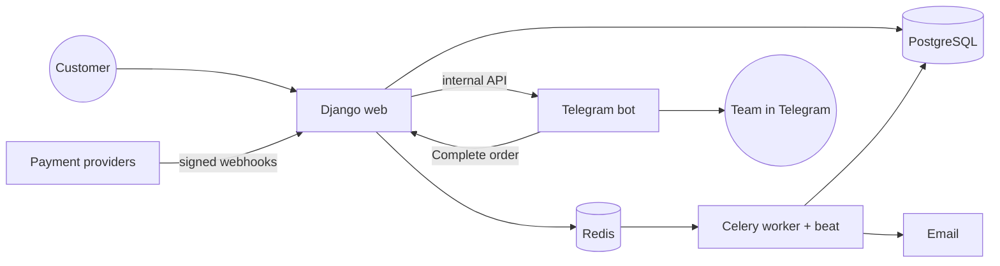

# Freestore — online store for digital goods

**Live demo → [ecom-demo.nnnik.com](https://ecom-demo.nnnik.com/)**
Test account: `demo` / `demo1234` — a buyer with real-looking order history, delivered codes and a wallet balance.

Freestore is a complete e-commerce platform for selling digital products: gift cards, game top-ups, subscriptions and activation keys. A customer picks a product, pays, and gets the code on the screen and by email in seconds — no manager involved. When a product needs a human (for example, activating a subscription on the customer's account), the order goes to the team in Telegram, and an operator completes it with one tap.

This is a production system, not a tutorial project. Freestore ran as a live store and **processed real customer payments** through crypto and card providers — with real stock, real refunds and real customers — deployed with CI/CD and monitored around the clock. I designed and built it end to end: product, backend, payments, infrastructure and operations.

---

## What it does

### For customers
- **Instant delivery.** Codes are issued automatically the moment payment is confirmed and shown on the order page and in the email.
- **Pre-orders.** If a product is out of stock, the customer can still pay; the order is delivered automatically as soon as new stock is uploaded.
- **Flexible products.** One product card can have many variants — region, denomination, plan, duration — with prices for each.
- **Personal account.** Order history with delivered codes, wallet balance, top-ups and a full transaction log.
- **Wallet.** Top up once, then buy in one click from the balance.
- **Easy sign-in.** Email and password, Google, Telegram, or straight from a Telegram Mini App.

### For the business
- **Telegram control room.** The team gets messages in a Telegram forum, sorted into topics:
  - new orders and paid pre-orders;
  - orders that need manual work, with a **"Complete"** button right in the chat;
  - wallet top-ups and new sign-ups;
  - errors and site health alerts (the bot checks that the site is up).
- **Manual fulfillment.** For services like "activate a subscription on my account", the customer fills in the required fields at checkout, and the operator sees them in Telegram.
- **No overselling.** Stock can be reserved when an order is created, so two people never get the same code.
- **Self-cleaning.** Unpaid orders are cancelled automatically, stuck manual orders are closed, payment statuses are re-checked in the background.
- **Admin panel** to manage the catalog, upload codes in bulk, enable or disable payment methods, and process orders.
- **Several payment providers** (crypto and card), each switchable from the admin panel without a deploy.

---

## How a purchase works

1. The customer opens a product, picks a variant (e.g. *USA / 20 USD*) and enters an email.
2. They pay with a payment provider or from the wallet.
3. The provider confirms the payment with a signed webhook.
4. **Instant product:** a code is taken from stock and delivered immediately.
   **Manual product:** the order goes to the Telegram "manual orders" topic, and an operator completes it.
   **Out of stock:** the order becomes a pre-order and is delivered when stock arrives.
5. The customer gets an email; the team sees the sale in Telegram.

---

## Services

| Service | What it does |
|---|---|
| **web** | Django storefront, customer account, admin panel, REST API, payment webhooks |
| **worker** | Celery: sends emails, delivers notifications, runs background jobs |
| **beat** | Celery scheduler: auto-cancels unpaid orders, re-checks payments, delivers pre-orders, retries failed notifications |
| **telegram-bot** | aiogram bot: team notifications in a forum, "Complete order" button, site health monitoring |
| **postgres** | Main database |
| **redis** | Task queue and cache |
| **mailserver** | Own mail server for transactional email (optional) |



---

## Tech stack

- **Backend:** Python 3.12, Django 6, Django REST Framework
- **Background jobs:** Celery + Celery Beat, Redis
- **Database:** PostgreSQL 16
- **Telegram bot:** aiogram 3, httpx
- **Frontend:** server-rendered Django templates, HTMX, Alpine.js
- **Payments:** NOWPayments (crypto), RollyPay, Enot.io — behind a common provider interface
- **Auth:** email/password, Google OAuth, Telegram OIDC and Mini App login, Cloudflare Turnstile
- **Infrastructure:** Docker Compose, Gunicorn, WhiteNoise, GitLab CI/CD, Sentry, Loguru

---

## Engineering highlights

- **Money is handled safely.** Every balance change is a wallet transaction with *balance before / after*; balance updates and stock reservations use row-level locks (`select_for_update`) inside transactions.
- **Idempotent checkout and payments.** Repeated clicks or duplicate webhooks never create a second order or a second charge.
- **Verified webhooks.** Provider signatures are checked, and every webhook is logged for auditing.
- **Pluggable payment providers.** Adding a new one means implementing one class (`create_invoice`, `verify_webhook`, `parse_webhook`).
- **Order state machine** with a full status history: who changed what and when.
- **Reliable notifications.** Telegram messages are queued and retried, so a Telegram outage never breaks a purchase.
- **Production-ready containers.** Non-root images, no secrets baked in, health checks, one compose file with profiles for every environment.

---

## Run locally

Requires Docker.

```bash
cp .env.example .env
docker compose up -d
docker compose exec web python manage.py createsuperuser
```

Open <http://localhost:8000> (admin panel at `/admin/`).

| Command | What starts |
|---|---|
| `docker compose up -d` | Store: web + PostgreSQL + Redis |
| `COMPOSE_PROFILES=workers,bot,mail` in `.env` | Full production stack |
| `docker compose -f docker-compose.yml -f docker-compose.dev.yml up --watch` | Development: live reload, Adminer, DB on localhost |

Payments, OAuth, captcha and Telegram turn on as soon as their keys are set in `.env`; everything works without them.

---

## Project structure

```
services/
├── django/
│   ├── apps/
│   │   ├── catalog/        # categories, products, variants, stock of codes
│   │   ├── orders/         # checkout, fulfillment, pre-orders, status history
│   │   ├── payments/       # providers, webhooks, wallet, refunds
│   │   ├── accounts/       # sign-in (email, Google, Telegram), profile
│   │   ├── notifications/  # transactional email
│   │   └── core/           # settings, health checks, shared helpers
│   ├── config/             # Django + Celery configuration
│   └── templates/
└── telegram-bot/           # aiogram bot: notifications, operator actions, monitoring
```

## Deployment

`.gitlab-ci.yml` deploys every push to the main branch in three steps — **build → deploy → cleanup** — on a Docker host behind a reverse proxy. The production `.env` lives only on the server.

## License

[MIT](LICENSE)
