<p align="center">
  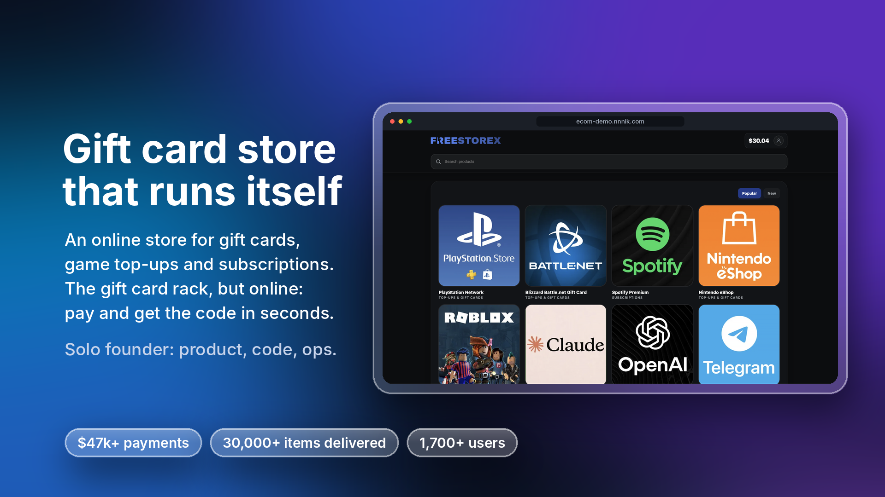
</p>

<h1 align="center">FreeStore</h1>

<p align="center">
  <b>An online store for digital gift cards, game top-ups and subscriptions.</b><br>
  Customers pay and get their code in seconds. The team runs everything from Telegram.
</p>

<p align="center">
  <a href="https://ecom-demo.nnnik.com/"><b>Live demo → ecom-demo.nnnik.com</b></a><br>
  Test account: <code>demo</code> / <code>demo1234</code>
</p>

<p align="center">
  
  
  
  
  
  
  
</p>

<p align="center">
  <a href="#walkthrough">Walkthrough</a> ·
  <a href="#management">Management</a> ·
  <a href="#results">Results</a> ·
  <a href="#engineering">Engineering</a> ·
  <a href="#run-locally">Run locally</a> ·
  <a href="#for-business">For business</a>
</p>

---

## 💡 The problem

Gift cards and top-up codes are simple products, but selling them by hand doesn't scale: a manager has to confirm every payment, find a code, send it, and answer "where is my code?" at 3 a.m. Every delay costs a sale, and every manual step is a chance to send the same code twice.

## ✅ The solution

FreeStore takes the payment, delivers the code on screen and by email in seconds, and keeps the team informed in Telegram, with no manager in the loop. When a product needs a human (for example, activating a subscription on the customer's account), the order goes to Telegram and an operator completes it with one tap.

This is a **production system, not a tutorial project**. It ran as a live store and processed real customer payments through card and crypto providers, with real stock, real refunds and real customers. I designed and built it end to end as a solo founder: product, backend, payments, infrastructure and operations.

> FreeStore started as a [Telegram shop bot](https://github.com/fpoweredd/shop-tgbot). Once the bot proved the demand, the store grew into this full web platform.

<a id="walkthrough"></a>

## 📸 Walkthrough

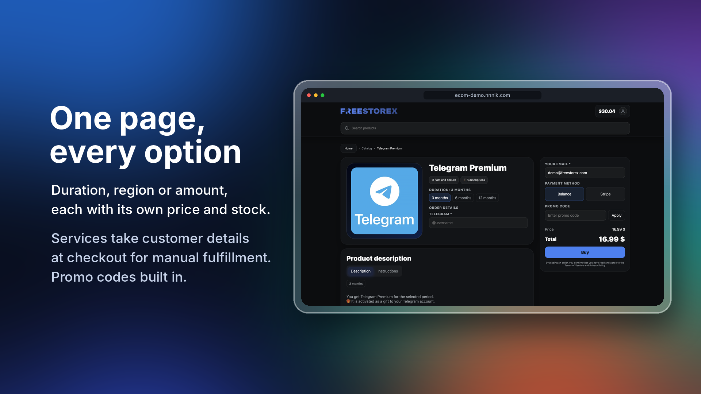

**One page, every option.** Duration, region or amount, each with its own price and stock. Services collect customer details at checkout for manual fulfillment. Promo codes built in.

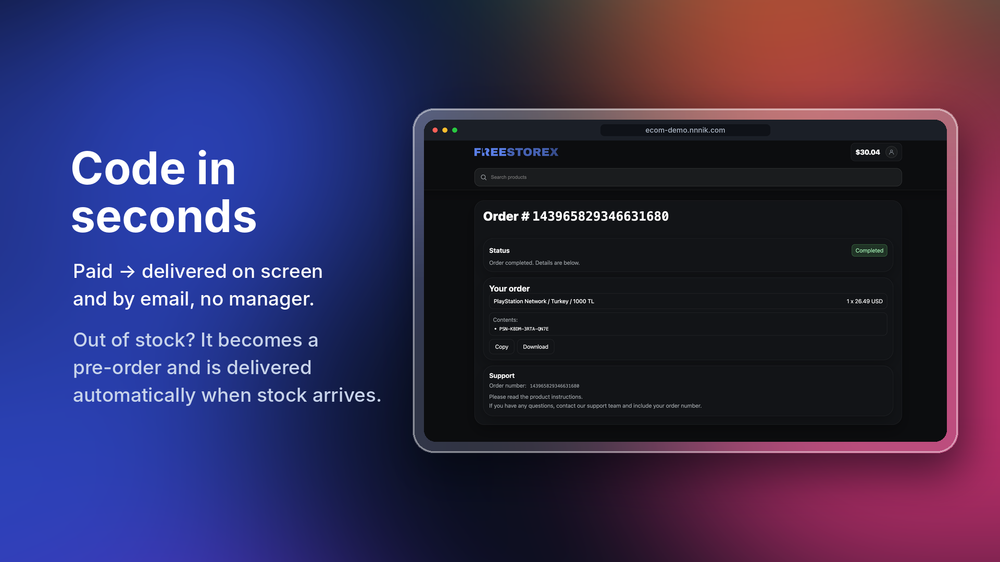

**Code in seconds.** Paid → delivered on screen and by email. Out of stock? The order becomes a pre-order and is delivered automatically when stock arrives.

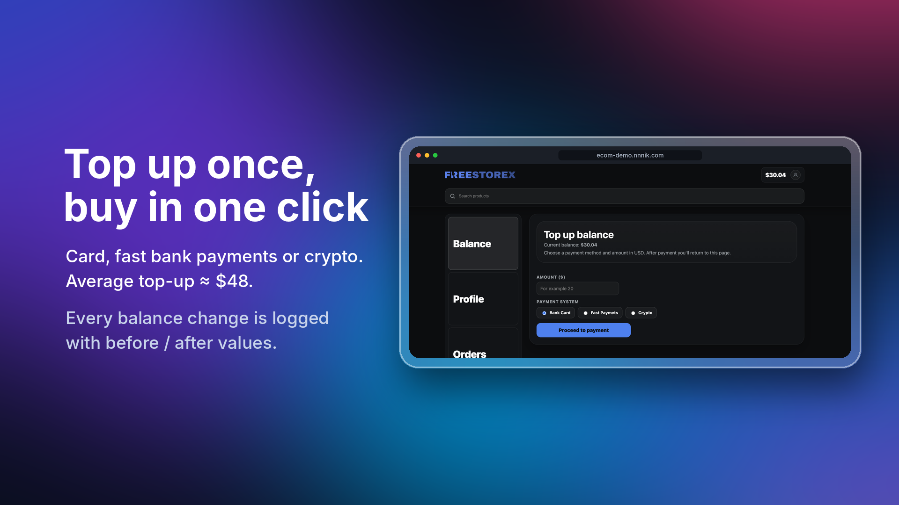

**Top up once, buy in one click.** Card, fast bank payments or crypto. Every balance change is logged with before and after values.

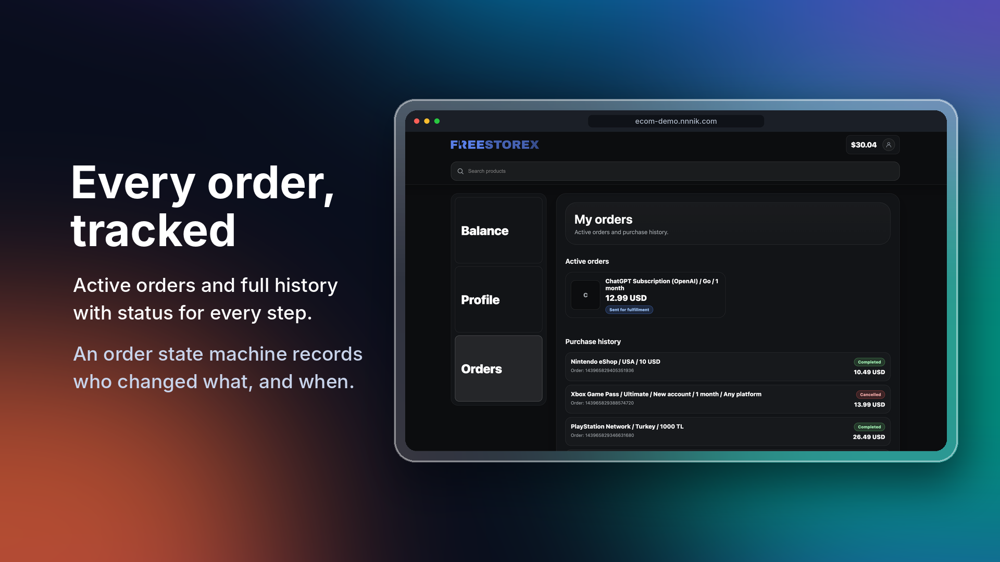

**Every order, tracked.** Active orders and full history. An order state machine records who changed what, and when.

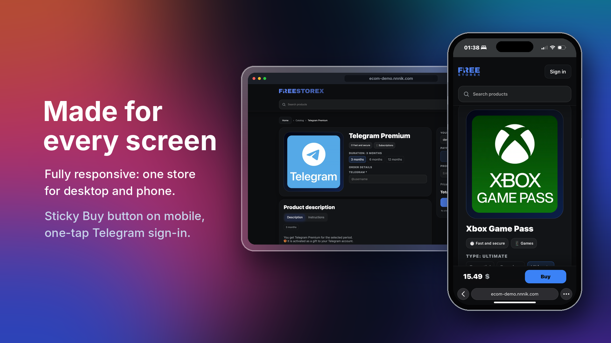

**Made for every screen.** Fully responsive, with a sticky Buy button on mobile and one-tap Telegram sign-in.

<a id="management"></a>

## 📲 Running the store from Telegram

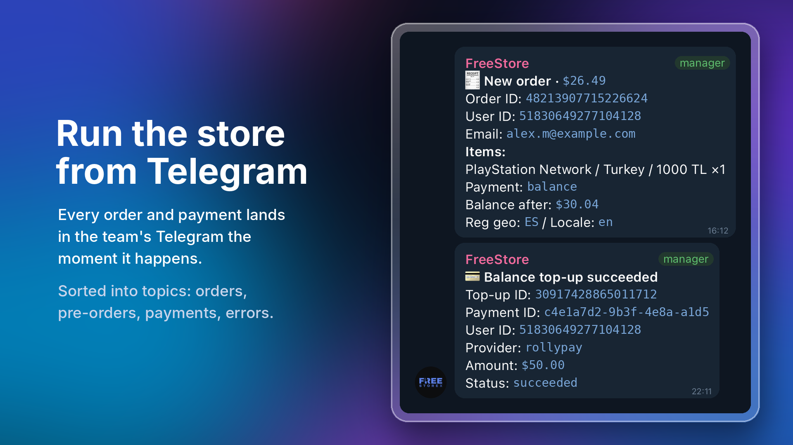

**Every order and payment** lands in the team's Telegram forum the moment it happens, sorted into topics: orders, pre-orders, payments, errors.

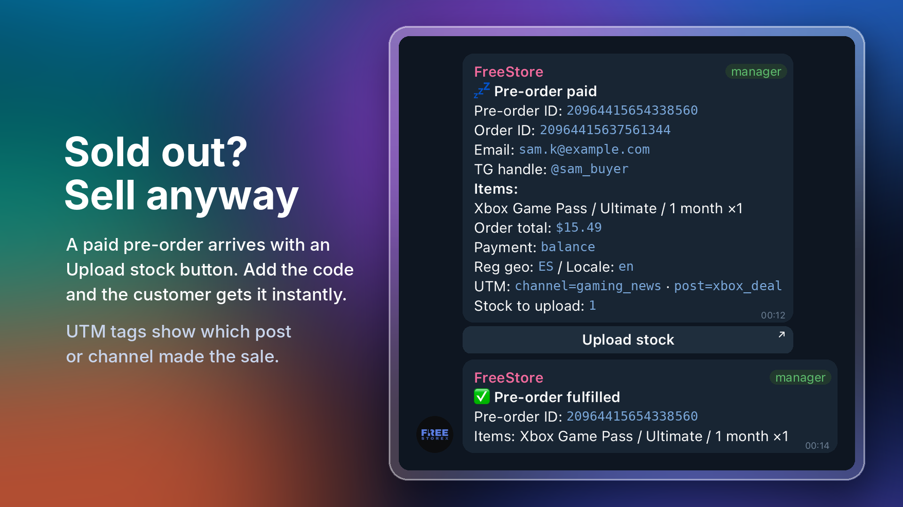

**Sold out? Sell anyway.** A paid pre-order arrives with an *Upload stock* button. Add the code and the customer gets it instantly. UTM tags show which post or channel made the sale.

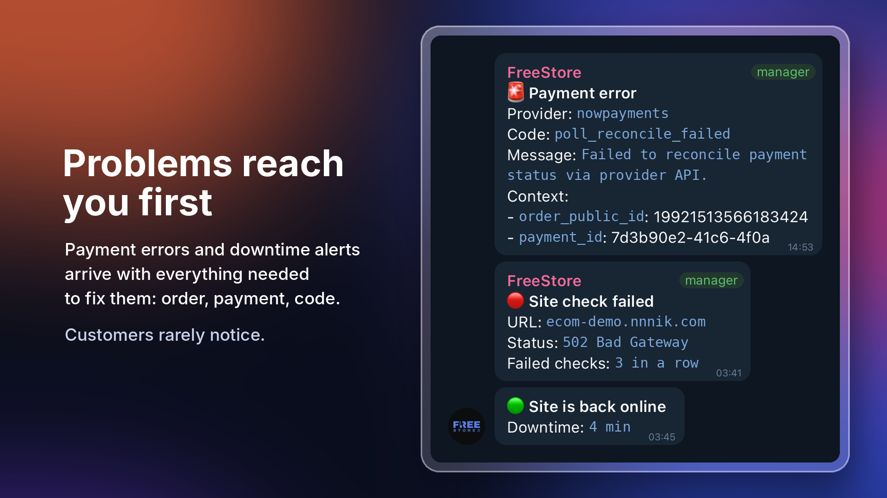

**Problems reach you first.** Payment errors and downtime alerts arrive with everything needed to fix them: order, payment, error code.

> Messages on the slides are shown in English with example data. IDs, emails and handles are fictional.

<a id="results"></a>

## 📈 Results

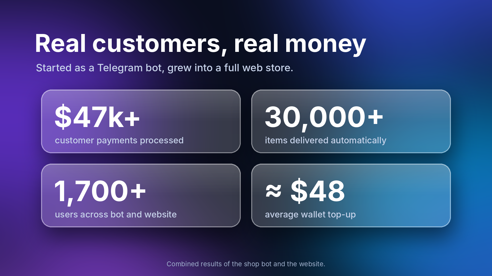

| | |
|---|---|
| **$47k+** | customer payments processed |
| **30,000+** | items delivered automatically |
| **1,700+** | users across the shop bot and the website |
| **≈ $48** | average wallet top-up |

Combined results of the shop bot and the website.

## ✨ What it does

### For customers
- **Instant delivery.** Codes are issued the moment payment is confirmed and shown on the order page and in the email.
- **Pre-orders.** If a product is out of stock, the customer can still pay; the order is delivered automatically as soon as new stock is uploaded.
- **Flexible products.** One product card can have many variants (region, denomination, plan, duration), each with its own price.
- **Personal account.** Order history with delivered codes, wallet balance, top-ups and a full transaction log.
- **Wallet.** Top up once, then buy in one click from the balance.
- **Easy sign-in.** Email and password, Google, Telegram, or straight from a Telegram Mini App.

### For the business
- **Telegram control room.** The team gets messages in a Telegram forum, sorted into topics: new orders and paid pre-orders; orders that need manual work, with a **"Complete"** button right in the chat; wallet top-ups and new sign-ups; errors and site health alerts.
- **Manual fulfillment.** For services like "activate a subscription on my account", the customer fills in the required fields at checkout, and the operator sees them in Telegram.
- **No overselling.** Stock is reserved when an order is created, so two people never get the same code.
- **Self-cleaning.** Unpaid orders are cancelled automatically, stuck manual orders are closed, payment statuses are re-checked in the background.
- **Admin panel** to manage the catalog, upload codes in bulk, enable or disable payment methods and process orders.
- **Several payment providers** (crypto and card), each switchable from the admin panel without a deploy.

## ⚙️ How a purchase works

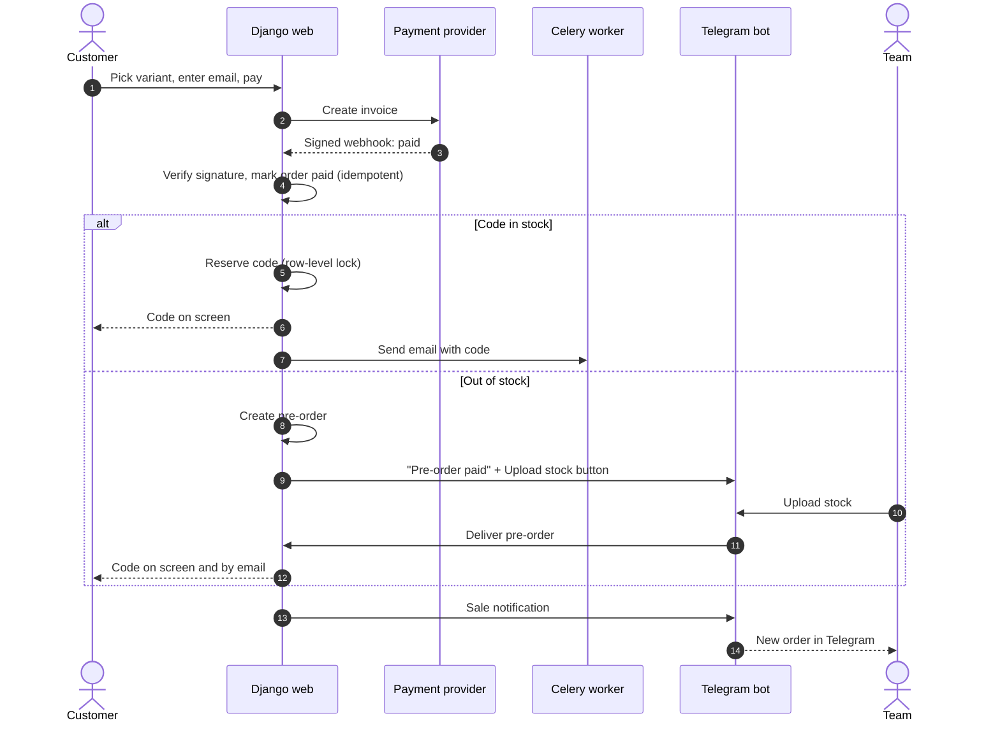

<a id="engineering"></a>

## 🛠️ Engineering highlights

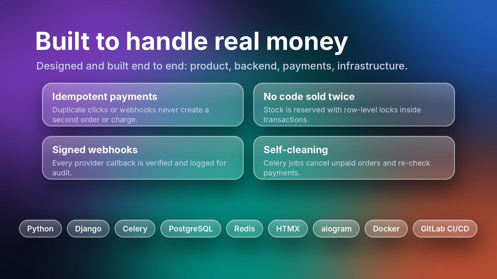

- **Money is handled safely.** Every balance change is a wallet transaction with *balance before / after*; balance updates and stock reservations use row-level locks (`select_for_update`) inside transactions.
- **Idempotent checkout and payments.** Repeated clicks or duplicate webhooks never create a second order or a second charge.
- **Verified webhooks.** Provider signatures are checked, and every webhook is logged for auditing.
- **Pluggable payment providers.** Adding a new one means implementing one class (`create_invoice`, `verify_webhook`, `parse_webhook`).
- **Order state machine** with a full status history: who changed what and when.
- **Reliable notifications.** Telegram messages are queued and retried, so a Telegram outage never breaks a purchase.
- **Production-ready containers.** Non-root images, no secrets baked in, health checks, one compose file with profiles for every environment.

### Services

| Service | What it does |
|---|---|
| **web** | Django storefront, customer account, admin panel, REST API, payment webhooks |
| **worker** | Celery: sends emails, delivers notifications, runs background jobs |
| **beat** | Celery scheduler: auto-cancels unpaid orders, re-checks payments, delivers pre-orders, retries failed notifications |
| **telegram-bot** | aiogram bot: team notifications in a forum, "Complete order" button, site health monitoring |
| **postgres** | Main database |
| **redis** | Task queue and cache |
| **mailserver** | Own mail server for transactional email (optional) |

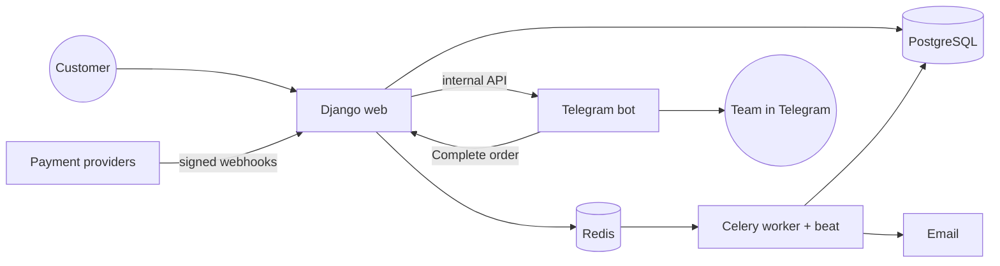

### Tech stack

- **Backend:** Python 3.12, Django 6, Django REST Framework
- **Background jobs:** Celery + Celery Beat, Redis
- **Database:** PostgreSQL 16
- **Telegram bot:** aiogram 3, httpx
- **Frontend:** server-rendered Django templates, HTMX, Alpine.js
- **Payments:** NOWPayments (crypto), RollyPay, Enot.io, behind a common provider interface
- **Auth:** email/password, Google OAuth, Telegram OIDC and Mini App login, Cloudflare Turnstile
- **Infrastructure:** Docker Compose, Gunicorn, WhiteNoise, GitLab CI/CD, Sentry, Loguru

<a id="run-locally"></a>

## 🚀 Run locally

Requires Docker.

```bash
cp .env.example .env
docker compose up -d
docker compose exec web python manage.py createsuperuser
```

Open <http://localhost:8000> (admin panel at `/admin/`).

| Command | What starts |
|---|---|
| `docker compose up -d` | Store: web + PostgreSQL + Redis |
| `COMPOSE_PROFILES=workers,bot,mail` in `.env` | Full production stack |
| `docker compose -f docker-compose.yml -f docker-compose.dev.yml up --watch` | Development: live reload, Adminer, DB on localhost |

Payments, OAuth, captcha and Telegram turn on as soon as their keys are set in `.env`; everything works without them.

### Project structure

```
services/
├── django/
│   ├── apps/
│   │   ├── catalog/        # categories, products, variants, stock of codes
│   │   ├── orders/         # checkout, fulfillment, pre-orders, status history
│   │   ├── payments/       # providers, webhooks, wallet, refunds
│   │   ├── accounts/       # sign-in (email, Google, Telegram), profile
│   │   ├── notifications/  # transactional email
│   │   └── core/           # settings, health checks, shared helpers
│   ├── config/             # Django + Celery configuration
│   └── templates/
└── telegram-bot/           # aiogram bot: notifications, operator actions, monitoring
```

### Deployment

`.gitlab-ci.yml` deploys every push to the main branch in three steps (**build → deploy → cleanup**) on a Docker host behind a reverse proxy. The production `.env` lives only on the server.

<a id="for-business"></a>

## 💼 For business

The same platform fits any business that sells something digital or service-based online:

| Use case | What changes |
|---|---|
| **Digital products** (licenses, courses, templates, gift cards) | Payment and delivery happen automatically, 24/7, with no one sending files or codes by hand. |
| **Services with manual steps** (activations, setups, bookings) | The customer fills in what's needed at checkout, and the team completes the order from Telegram in one tap. |
| **Resellers and B2B clients** | Wallet balances, bulk purchases and promo codes let regular buyers order in seconds. |
| **Any online shop** | Order, payment and error alerts in Telegram mean the owner always knows what's happening, even away from the computer. |

**Running an online business on spreadsheets, messages and manual steps?** I build web stores, client portals and internal tools that take payments, process orders and keep your team informed automatically. See [my GitHub profile](https://github.com/fpoweredd) for more!

## License

[MIT](LICENSE)
